# Teeworlds — Myelin Edition

Play at **https://store.utxoplay.io/play/teeworlds**.

A modified distribution of [xxuejie's Teeworlds on CKB fork](https://github.com/xxuejie/teeworlds/tree/f77e39e5fa5bfa0b4831d8d6d7c4690183807a29), adapted to Myelin and UTXOPlay. This preserves the original fixed-point game simulation and provides a new Canvas browser renderer, practice bot, private online duels, and signed, independently replayable match records.

## Play

Use A/D or the arrow keys to move, Space to double jump, mouse to aim, left click to fire, right click to hook, and 1–5 to select a collected weapon. Practice starts immediately against a basic bot. Create a duel and share the room code with a friend; the match starts when they join. Each round lasts 60 seconds. Mobile has touch controls, while mouse and keyboard provide the best control.

UTXOPlay handles guest or CKB-compatible wallet login. The room service only accepts the authenticated account supplied by the private platform gateway. Players never supply a numeric room slot. Both participants can download the same completed match export.

## Architecture

```mermaid
flowchart LR
  Browser[Canvas browser client] --> Gateway[UTXOPlay authenticated gateway]
  Gateway --> Rooms[Private Node room service]
  Rooms --> Engine[Original C++ simulation at 50 Hz]
  Engine --> Tape[Canonical input tape + final gameplay snapshot]
  Tape --> Replay[Independent native replay]
  Replay --> Myelin[Myelin SessionChain + PoA finality]
  Myelin --> Store[Persistent match record + downloadable export]
```



- `src/browser/bridge.cpp`: a long-lived upstream `ReplayGame` invocation with streamed inputs and snapshots. Current character cores are exposed by a read-only accessor to avoid desktop-client dead-reckoning assumptions. Physics, collisions, hooks, weapons, pickups, and scoring remain upstream code.
- `service/server.mjs`: two-player membership, a server-controlled tick clock, ordered bounded inputs, stale-input neutralization, room expiration, and bounded verification work. Live matches run natively; the browser only renders and submits controls.
- `myelin/`: a Rust `TransitionExecutor` that validates the tape grammar, independently runs the pinned native engine, compares its result, and commits one complete match as a Myelin frame. The application profile commits to the exact bridge binary, map, config, adapter, and dependency lockfile. The frame includes participants, room, full tape, and result; Myelin's cryptographic commitments bind them together.
- `web/`: browser client and attribution. `web/assets/map.json` contains the actual dm1 collision layer emitted by the bridge. The map's presentation is new; its geometry is unchanged.

This is a **native replay and Myelin session release**. It does not submit matches to CKB, claim CKB-VM cycle measurements, establish permissionless consensus, or prove fair server input ordering. Upstream CKB tools remain in `ckb/` and `rust-tools/`; their original instructions are in [README.upstream.md](README.upstream.md). Myelin's existing `teeworlds vm-probe` command can separately run a built upstream RISC-V replayer. That is not the production store execution path.

The upstream 32-bit CRC is retained for compatibility and is not treated as a cryptographic state hash. Export verification re-executes the committed tape and checks Myelin state roots and signatures. An export is self-contained; trusting a particular issuing authority is a separate policy from checking replay consistency.

## Build

Node 22.23+, Rust 1.97.1, CMake, Ninja, Clang/libclang, protobuf, Python 3, and zlib development headers are required. The Myelin dependencies are pinned to `5c38d13348e1d2673ae52c742dabce0aa0308195`.

```sh
git clone --recurse-submodules https://github.com/Myelin-Labs/myelin-teeworlds
cd myelin-teeworlds
./scripts/build-utxoplay.sh
```

For Linux x86-64 Bookworm-compatible binaries, build inside `deploy/Builder.Dockerfile` (Docker or Podman), mount the checkout at `/src`, and run the script there. The exact bridge bytes are part of the application profile. Do not strip or replace the bridge after compiling the Myelin verifier. Keep released engine/verifier pairs with archived exports.

The GitHub release bundle includes this matching pair in `release/`, the map/config, web client, service, and source revision. No runtime keys or account data are included.

## Run and integrate

Set a random `RUNTIME_TOKEN` of at least 32 characters through your environment or a private server-side secret file. Do not put it in a game bundle or Git. Then:

```sh
npm ci --prefix service
node service/server.mjs
```

The default bind is `127.0.0.1:8783`; `BIND`, `PORT`, `DATA_DIR`, and `TEEWORLDS_ASSETS` are configurable. `MATCH_TICKS` is for bounded local tests (50–3000); production defaults to 3000.

Live controls use a persistent WebSocket. Movement/jump/fire changes are sent immediately; pointer input is sampled at up to 50 Hz. The native engine publishes snapshots at 25 Hz. The local character displays the latest authoritative position; only remote characters interpolate over 40 ms. There is no local movement prediction. A failed socket reconnects automatically and uses the HTTP compatibility path until ready. The HUD reports round-trip time, not total input-to-display latency.

Host `web/` at `/games/teeworlds/`. Forward authenticated `/games/teeworlds/api/{state,action,export}` requests to this service's `/api/` routes, injecting `X-Runtime-Token` and the 64-character account identifier in `X-UTXOPlay-Account`. Enforce same-origin writes and account/IP quotas at the gateway. Never expose this service directly to browsers or trust account headers supplied by them. UTXOPlay's deployment supplies these controls.

Proxy same-origin WebSocket upgrades from `/games/teeworlds/api/socket` to `/api/socket` with the same server-injected credentials. Authenticate the upgrade cookie and its exact Origin, recheck session validity on traffic, bound message size/rate and queued bytes, and close upstream connections when the browser leaves. The private runtime emits `{type:"ready"}`, `{type:"state",room}`, and `{type:"pong",time}` messages. Send `{type:"input",room,input}` or `{type:"ping",time}`; create/join/leave remain HTTP actions. State includes `appliedSeq`, the latest input sequence consumed by the engine for that snapshot, for measuring input-to-authoritative-state latency.

Actions: `{type:"create",mode:"practice"|"duel"}`, `{type:"join",room}`, `{type:"input",room,input}`, and `{type:"leave"}`. Controls contain `direction`, `x`, `y`, `jump`, `fire`, `hook`, `weapon`, and monotonic `seq`. Fire is the upstream six-bit edge counter, not a boolean. Simulation time and participant slots are never client-controlled.

```sh
node tests/acceptance.mjs
cargo test --locked --manifest-path myelin/Cargo.toml
TEEWORLDS_ASSETS=./release ./release/myelin-teeworlds verify downloaded-export.json
```

The acceptance test uses disposable identities and short real matches. It checks two-player membership, cross-account isolation, malformed input rejection, native replay, Myelin sealing, independent export verification, tampering, and persistence across a service restart.

## Operations and limits

Keep `DATA_DIR` private and writable by the container user. It contains room metadata, input tapes, participants, Myelin records, and signing keys. Finished match exports persist across restarts. Unfinished matches are marked interrupted after restart; they are not represented as verified. Waiting rooms expire after five minutes. The first release caps active/waiting/sealing rooms at eight and serializes replay workers. UTXOPlay additionally limits each account to 20 room creations per hour.

The Docker image runs as a non-root user. Its deployment uses a private network, read-only root filesystem, dropped capabilities, memory/CPU/PID limits, and a persistent data volume. Preserve the previous image and corresponding artifacts for rollback. Back up data while writers are stopped. Automatic backup/retention scheduling is outside this release.

## Provenance and licenses

- Original Teeworlds: Magnus Auvinen and contributors; source retains [license.txt](license.txt).
- Fixed-point/CKB adaptation: xxuejie, pinned upstream commit `f77e39e5fa5bfa0b4831d8d6d7c4690183807a29`. [Article](https://xuejie.space/2026_06_16_teeworlds_on_ckb/).
- UTXOPlay browser and Myelin integration: Myelin Labs. This is explicitly a modified distribution, not the original official client.
- Teeworlds data/map/skin/weapon assets and derived presentation/cover art: CC BY-SA 3.0, with full author attribution in [web/credits.html](web/credits.html). Original artwork files are copied without image alteration; Canvas applies tint/layout at rendering time.
- The Myelin session adapter derives from the MIT-licensed Myelin Chess adapter; its MIT notice is retained in `myelin/LICENSE`. Third-party notices inside upstream source remain intact.
